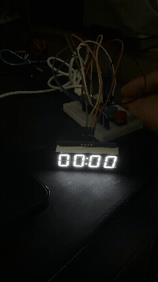

# Ping-Pong-Tracker

An Arduino scoreboard for ping pong. Each player has one button to add (or undo) their points, and the score shows on a 4-digit 7-segment LED display as `P1:P2`.

## Hardware

| Part | Notes |
|---|---|
| Arduino Nano R4 (with headers) | The microcontroller |
| Adafruit 0.56" 4-digit 7-segment LED display (HT16K33 backpack) | Talks to the Nano over I2C, address `0x70` |
| 2 × momentary push buttons with colored caps | Blue = Player 1, Red = Player 2 |
| 400-point breadboard | Holds the Nano and buttons |
| 9V battery + battery snap | Powers the Nano through VIN when not on USB |
| Dupont jumper wires (M-M, M-F, F-F) | |
| Soldering iron + solder | To solder the display onto its backpack and attach the header pins |

No resistors are needed for the buttons because the sketch uses the Nano's internal pull-ups.

## Wiring

**Display (I2C)**

Use male-to-female jumper wires from the backpack pins to the breadboard.

| Display backpack pin | Nano R4 |
|---|---|
| `+` | 5V |
| `-` | GND |
| SDA | SDA (A4) |
| SCL | SCL (A5) |

**Buttons**

Each button connects between a digital pin and GND.

| Button | Player | One leg | Other leg |
|---|---|---|---|
| Blue | Player 1 (left score) | D2 | GND |
| Red | Player 2 (right score) | D3 | GND |

**Power**

Over USB, the Nano powers itself and the display.

On battery, connect the 9V snap straight to the Nano:

| 9V snap wire | Nano R4 |
|---|---|
| Red | VIN |
| Black | GND |

The Nano's onboard regulator turns the 9V into 5V for the display.

## Libraries

Install these in the Arduino IDE under **Tools → Manage Libraries…**:

- **Adafruit LED Backpack Library**
- **Adafruit GFX Library**
- **Adafruit BusIO** (usually installed automatically as a dependency)

`Wire` comes with the Arduino IDE.

## Uploading

1. Open `PingPongTracker/PingPongTracker.ino` in the Arduino IDE.
2. If the Nano R4 isn't listed under **Tools → Board**, install its board package from **Tools → Board → Boards Manager** (search for "Nano R4").
3. Select **Arduino Nano R4** under **Tools → Board** and its port under **Tools → Port**.
4. Click **Upload**.

The display should show `00:00`.

## How to use

| Action | Result |
|---|---|
| Press a player's button once | +1 point for that player (counts about 0.5 s after you let go) |
| Double-press a player's button quickly | −1 point for that player (undo a mistake; never goes below 0) |
| Hold both buttons for 2 seconds | Reset the score to `00:00` |

Player 1 (blue) is on the left of the colon, Player 2 (red) on the right.

The sketch also prints each score change to the Serial Monitor at 9600 baud, which helps when debugging.

## Settings

These constants at the top of the sketch control the timing:

| Constant | Default | What it does |
|---|---|---|
| `delayClick` | `500` ms | Window for a double-press to count as an undo |
| `interval` | `2000` ms | How long both buttons must be held to reset |

The display I2C address is set in `display.begin(0x70)`. Change it if you've soldered the backpack's address jumpers.
